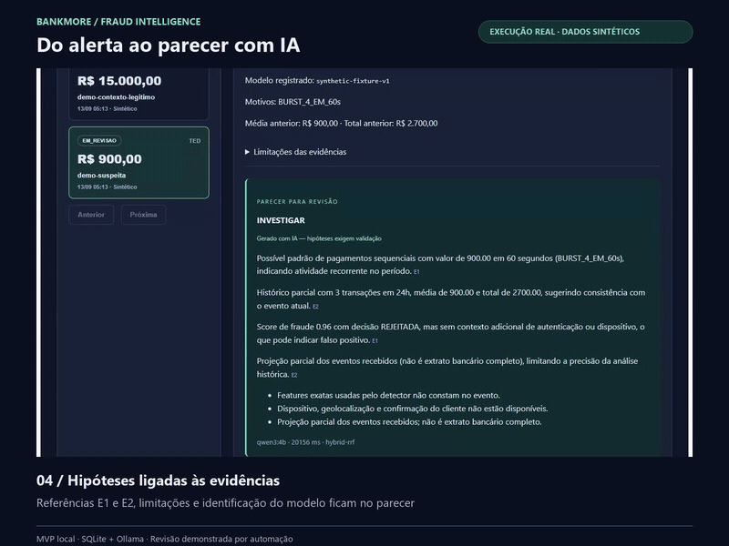
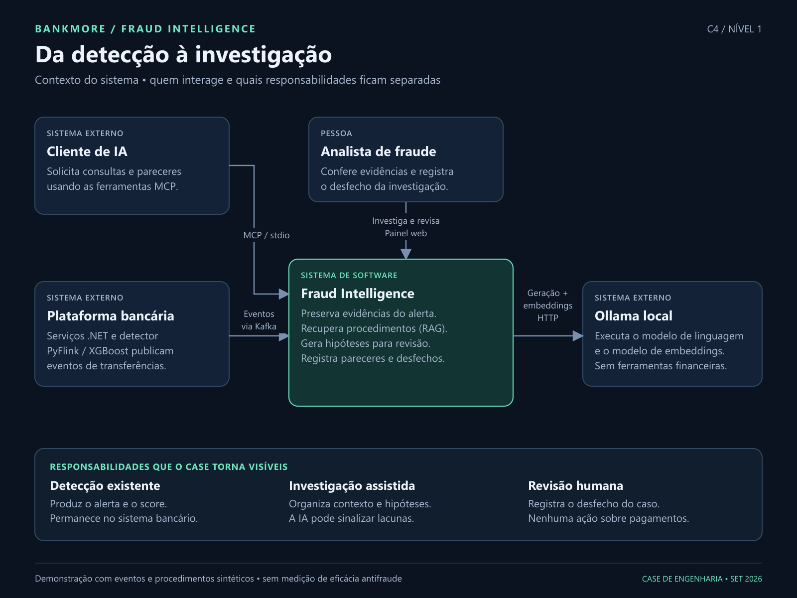
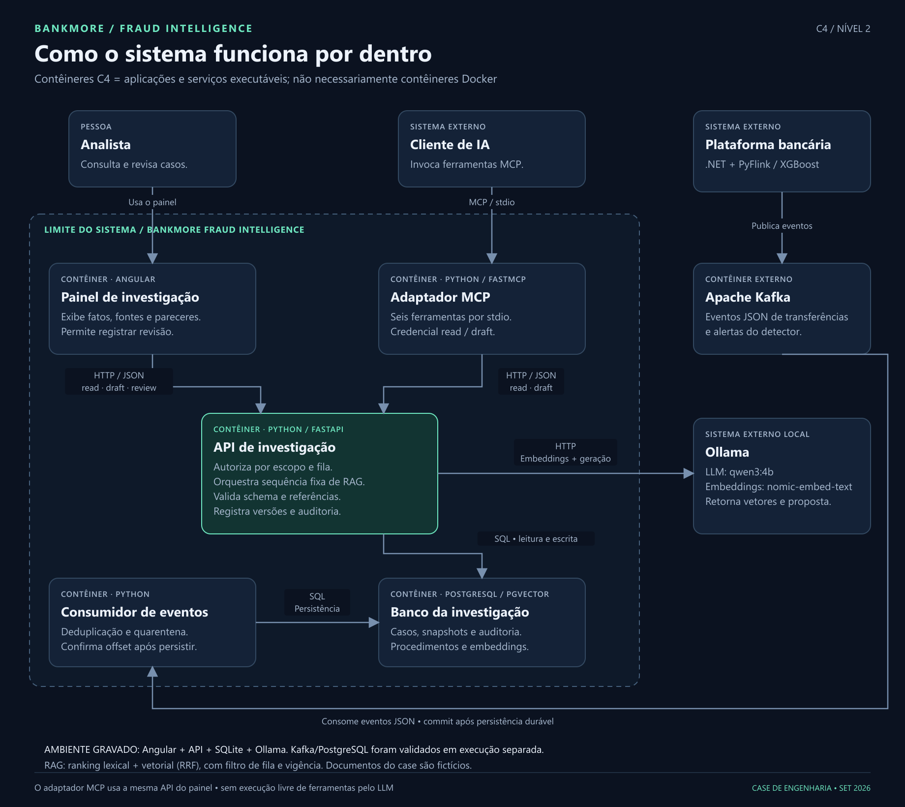

# BankMore Fraud Intelligence — demonstração e C4

**Evolução posterior à gravação:** [fluxo integrado com score calculado pelo detector, PostgreSQL e seis ferramentas MCP](../../investigation/LIVE_VALIDATION.md). A prévia abaixo registra a primeira demo com casos pré-carregados.

O módulo transforma alertas de transferências em casos com evidências preservadas, contexto documental e pareceres para revisão. O painel e o adaptador MCP usam a mesma API autenticada. A IA não executa ações financeiras.

## Aplicação em execução

Prévia de 17 segundos, gravada na aplicação real com eventos e procedimentos sintéticos. A API usa Ollama (`qwen3:4b`, embeddings `nomic-embed-text:latest`) e recuperação híbrida. A gravação usa SQLite. O score exibido vem de uma fixture de demonstração, não de uma nova execução do detector.

O roteiro completo inclui geração, consulta às fontes e encerramento sintético como inconclusivo. A etapa destinada à revisão humana foi operada por automação de navegador para demonstrar a interface; não representa avaliação especializada de fraude.

## C4 — contexto

A plataforma bancária publica eventos; Fraud Intelligence organiza evidências e pareceres; o analista registra o desfecho. Ollama fornece inferência e embeddings. O cliente MCP tem acesso controlado às ferramentas de investigação.

## C4 — contêineres

No C4, contêiner representa uma aplicação ou armazenamento executável, não necessariamente um contêiner Docker. O banco dedicado PostgreSQL/pgvector e o consumidor Kafka foram validados separadamente da gravação. A API executa uma sequência fixa de recuperação e geração; não há execução livre de ferramentas pelo LLM.

Arquivos vetoriais editáveis: [contexto](c4-01-contexto.svg) e [contêineres](c4-02-conteineres.svg).

## Executar e verificar

- [Instalação, modelos locais, configuração MCP e Docker](../../investigation/README.md)
- [Resultados e limites da validação](../../investigation/VALIDATION.md)
- [ADR 0021 — decisões de arquitetura](../adr/0021-investigacao-mcp-rag.md)

O fluxo completo .NET/PyFlink/PIX não foi executado nessa validação. O MVP não mede eficácia antifraude, redução de falsos positivos ou produtividade de analistas.
