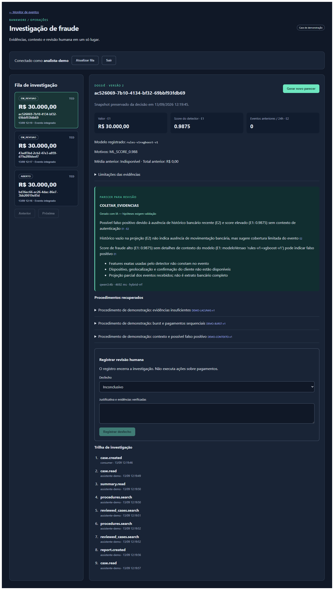

# Transferência real do sistema → detector → MCP

Validado em 13/09/2026, em ambiente local isolado `bankmore-live`.

As contas, saldos e transferências são fictícios. O processamento executa as APIs,
outbox, consumidor de liquidação, PyFlink e XGBoost do repositório. O roteiro não
publica alertas manualmente, não pré-carrega casos de investigação e não fixa scores.
Não conecta uma instituição financeira nem confirma a ocorrência de um crime real.

## Resultado observado

| Verificação | Resultado |
|---|---|
| TED de controle — R$ 200 | EFETIVADA; três movimentos registrados, incluindo tarifa |
| TED de teste — R$ 30.000 | REJEITADA; motivo `ML_SCORE_0.988` |
| Score calculado | `0.9875`, modelo `rules-v1+xgboost-v1` |
| Movimentos da transferência rejeitada | Zero: não houve débito nem crédito originado por ela |
| Fonte do caso | Evento JSON emitido pelo detector e consumido via Kafka |
| MCP | Descoberta e execução das seis ferramentas pelo SDK oficial via stdio |
| Recuperação | PostgreSQL/pgvector + embeddings Ollama, `hybrid-rrf` |
| Geração | Ollama `qwen3:4b`, prompt `investigation-v2`, sem fallback |
| Parecer | `COLETAR_EVIDENCIAS`: sem histórico desse cliente na projeção da investigação |
| Tempo do parecer | 4.692 ms em uma execução local; não é benchmark ou SLA |
| Revisão com credencial do assistente | HTTP 403; caso continua aberto para revisão |
| Painel | Caso integrado e parecer persistido exibidos em `/ops/investigacao` |

O detector rejeitou a transferência pelo score; o parecer pede evidências adicionais
para investigar o alerta. Essas são responsabilidades diferentes. A recomendação
do LLM não libera nem bloqueia pagamentos. O XGBoost foi treinado pelo script do
projeto com dados sintéticos; esse teste comprova integração, não eficácia em dados
bancários de produção.

Os IDs da execução e metadados permitidos estão em [live-evidence.json](live-evidence.json).
CPF bruto, senhas e tokens não são exportados nesse relatório.



## Reproduzir

Requer Docker, Ollama no host com os modelos configurados, Python do projeto e
`investigation/.env.local` gerado por `setup-demo`. Preserve esse arquivo privado.
Não execute `seed-demo` nessa stack: os casos são criados a partir das transferências.

```powershell
# Na raiz do repositório. Pare a API nativa de demonstração se ocupar a porta 5010.
docker compose --env-file investigation/.env.local -f investigation/compose.live.yml up -d --build --wait
docker compose --env-file investigation/.env.local -f investigation/compose.live.yml exec -T intelligence-api python -m bankmore_intelligence index-knowledge
.venv/Scripts/python.exe investigation/scripts/check_live_mcp.py
```

O script cria três novas contas fictícias a cada execução nas APIs locais `5100` e
`5101`, verifica o projeto Docker antes de operar e consulta o banco bancário de
teste para conferir a liquidação. Essa consulta pertence ao verificador: a API de
investigação e o MCP continuam sem credenciais do ledger.

O painel Angular existente usa `localhost:5010`, agora conectado ao PostgreSQL
dessa stack. A configuração MCP por stdio descrita no README continua válida.
As credenciais de análise/revisão são as de `investigation/.env.local`.

Para parar somente este ambiente, preservando os dados:

```powershell
docker compose --env-file investigation/.env.local -f investigation/compose.live.yml stop
```

## Ambiente e limites

- Bancos e rede pertencem ao projeto `bankmore-live`; não usa volumes de outros projetos.
- Portas publicadas somente em loopback: contas `5100`, transferências `5101`, investigação `5010`.
- Redis e Kafka ficam na rede Docker, sem portas publicadas no host.
- O transporte desse teste é JSON, uma opção já suportada pelo produtor e pelo detector. Não valida Avro/Schema Registry.
- Apache Kafka 3.9.1, PostgreSQL 16, pgvector, Redis, .NET 8, PyFlink 1.18.1 e XGBoost do projeto.
- A imagem alternativa `live-runtime.Dockerfile` utiliza uma base Microsoft já disponível, pois os downloads de camadas do Docker Hub falharam. PyFlink roda com Python 3.10.19 e Java 17, cujo suporte no Flink 1.18 é experimental. É runtime local de validação, não uma recomendação de implantação produtiva.
- `setuptools==80.9.0` mantém `pkg_resources`, usado pelo Apache Beam dessa versão do PyFlink.
- Caso o pull de pgvector falhe, construa `investigation/docker/pgvector.Dockerfile` e defina `$env:INTELLIGENCE_POSTGRES_IMAGE='bankmore-pgvector:pg16'`, conforme o README.
- O ML foi reiniciado após a configuração do Redis; a conexão com o feature store foi confirmada antes da execução registrada.
- PIX/DICT/SPI, APIs bancárias externas, políticas reais, eficácia antifraude e avaliação especializada permanecem fora desta validação.

O vídeo/GIF anterior em `docs/showcase` mostra os casos pré-carregados da primeira
demo. A captura e os resultados desta página documentam a integração posterior.
