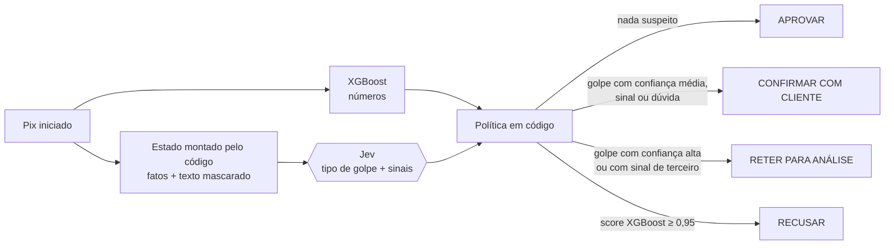

# Antifraude Pix com o Jev

**O XGBoost lê os números, o Jev lê o contexto, o código decide.**

O antifraude inline do Pix ([ADR 0018](../docs/adr/0018-sprint9-antifraude-inline-pix.md)) usa um XGBoost com features numéricas: valor, hora, dia da semana, quantidade de Pix na última hora, valores habituais. Ele é bom no que é anomalia de número. Golpes de engenharia social, como o do falso parente, muitas vezes não são: o valor é normal, o horário é normal e a cliente é a dona da conta. Parte do sinal está no destinatário (primeiro Pix, chave recém-criada), que o XGBoost atual não usa. O resto está no contexto: "meu filho trocou de número e pediu para pagar um boleto urgente".

Este módulo põe o [Jev](https://docs.typesafe.ai/) (TypeSafe AI) como **segunda camada** depois do XGBoost. O Jev é um modelo de decisão: devolve escolhas tipadas com probabilidade e confiança e não gera texto. É um módulo Python à parte, com uma tela no frontend (`/ops/jev`, veja abaixo). A integração no fluxo .NET está desenhada no [ADR 0022](../docs/adr/0022-jev-segunda-camada-antifraude-pix.md), mas ainda não foi implementada.



## Rodando

Requer Python 3.10 ou mais novo e não tem dependências: usa só a biblioteca padrão. Rode os comandos da raiz do repositório, porque o `PYTHONPATH` é relativo.

```powershell
$env:PYTHONPATH = 'jev'
$env:TYPESAFE_API_KEY = '<sua chave>'      # só na sessão do terminal; nunca em arquivo

python -m bankmore_jev                     # 8 cenários com o Jev ao vivo
python -m bankmore_jev --nenhum-primeiro   # o mesmo, com 'nenhum' como 1ª opção (viés de ordem)
python -m bankmore_jev --cenario 2         # só o golpe do falso parente
python -m bankmore_jev --json              # uma linha JSON (ASCII) por cenário
python -m bankmore_jev --offline           # respostas SIMULADAS, para quem não tem chave

Remove-Item Env:TYPESAFE_API_KEY           # ao terminar
```

Com a stack de pé (`make up`), a opção `--ml-url http://localhost:5003` troca o score de exemplo pelo score real do `fraud-ml`. A demo chama o mesmo `/predict` do `FraudeClient`, com três diferenças:

- não envia `cpfOrigem`, então o `fraud-ml` não consulta o Redis;
- `valor_p95_cpf_30d` vai direto do cenário, e `valor_medio_cpf_24h` também quando o cenário o define (5 e 6); nos outros, o `fraud-ml` usa o próprio valor do Pix;
- `dow` é fixo em 1.

Por isso, os scores reais podem ser diferentes dos de exemplo.

Variáveis opcionais:

- `TYPESAFE_MODEL`: o padrão é `jev-1.13.0`, uma versão fixa. O alias `jev-latest` muda a cada release, e a confiança muda junto. Troque de versão só depois de recalibrar os limiares.
- `JEV_TIMEOUT_S`: o padrão é `2.0`. É o prazo total de cada chamada, não o de cada operação de socket. Aceita valores acima de 0 e até 30 s, com ponto ou vírgula decimal.

A saída é UTF-8. Se o PowerShell mostrar acentos trocados ao redirecionar, rode antes `[Console]::OutputEncoding = [Text.Encoding]::UTF8`.

## Tela no BankMore

A tela `/ops/jev` do frontend Angular mostra cada Pix passando pelas duas camadas:

- a decisão em três etapas: XGBoost (números) → Jev (contexto) → política (código), com a comparação "só XGBoost × com Jev";
- as probabilidades de cada golpe e os sinais de terceiro, com os limiares da política;
- o que saiu do banco: o estado enviado ao Jev, com os dados pessoais trocados por marcadores destacados;
- os 8 cenários em sequência, com o placar no fim;
- um Pix personalizado: você escreve o motivo e vê o Jev decidir na hora.

Em dois terminais, da raiz do repositório:

```powershell
# terminal 1: API local da tela (porta 5011)
$env:PYTHONPATH = 'jev'
$env:TYPESAFE_API_KEY = '<sua chave>'
python -m bankmore_jev --api              # sem chave: python -m bankmore_jev --api --offline

# terminal 2: frontend
cd frontend
npm ci                                    # só na primeira vez
npm start
```

Abra http://localhost:4200/ops/jev. A tela não exige login nem a stack Docker. Se o PowerShell recusar o `npm` por política de execução de scripts, use `npm.cmd ci` e `npm.cmd start`.

A API escuta só em 127.0.0.1 e aceita CORS apenas do `ng serve` local, em `http://localhost:4200` e `http://127.0.0.1:4200` (mude com `JEV_ORIGINS`). Se a porta 5011 já estiver ocupada por outra API, ela se recusa a subir, em vez de dividir a porta. Ela também confere o `Host` e exige JSON, para outra página aberta no navegador não conseguir usar a sua chave.

No Windows, deixe o repositório num caminho curto (ex.: `C:\dev\BankMore-Challenge`): em pastas muito profundas, o `node_modules` passa do limite de 260 caracteres. O npm 11 pode avisar que bloqueou scripts de instalação (esbuild, lmdb); a tela funciona sem eles.

## Como decide

Uma única chamada ao Jev faz três perguntas (padrão *fan-out* da TypeSafe):

| Pergunta | Tipo | O que mede |
|---|---|---|
| `golpe` | Choice | `falso_parente`, `falsa_central`, `falso_vendedor`, `outro_golpe` ou `nenhum`, com confiança |
| `pressao_de_terceiro` | Noul | urgência, pressão ou segredo imposto por outra pessoa |
| `instruido_por_terceiro` | Noul | pagamento instruído por ligação ou mensagem, não por iniciativa própria |

A política (`policy.py`) aplica, nesta ordem:

| Regra | Ação |
|---|---|
| Score do XGBoost ≥ 0,95 | RECUSAR (o XGBoost continua soberano nos números) |
| Confiança do Jev < 0,6 | CONFIRMAR COM CLIENTE (dúvida) |
| Golpe com confiança ≥ 0,85 | RETER PARA ANÁLISE |
| Golpe com confiança entre 0,6 e 0,85 e sinal de terceiro ≥ 0,8 | RETER PARA ANÁLISE |
| Golpe com confiança entre 0,6 e 0,85, sem sinal | CONFIRMAR COM CLIENTE |
| Sinal de terceiro ≥ 0,8, sem golpe | CONFIRMAR COM CLIENTE |
| Resposta parcial | usa o que veio, porque só pode acrescentar cautela |
| Jev fora do ar, lento ou fora do contrato | vale só o XGBoost (fail-open, como o ADR 0004) |

Um golpe identificado com sinal de terceiro vai para retenção porque confirmar com o cliente é um controle fraco quando o golpista está orientando a vítima na tela.

RETER PARA ANÁLISE significa que o BankMore, como PSP do pagador, segura o Pix antes de enviá-lo ao SPI e aciona análise humana. Não é o bloqueio cautelar da Res. BCB 147/2021, que cabe ao PSP recebedor.

Sobre os limiares:

- 0,6 e 0,85 vêm do padrão *confidence routing* da TypeSafe. Lá o critério é "> 0,85"; aqui o empate retém, por cautela.
- O 0,8 dos sinais é escolha deste módulo.
- Todos são ponto de partida: calibre com Pix reais.

**O Jev só pode aumentar a cautela.** A decisão final é a mais restritiva entre a do XGBoost e a do Jev, e um teste verifica isso em mais de 1.600 combinações. O texto que o Jev lê é digitado pelo cliente, às vezes ditado pelo golpista, e a própria TypeSafe avisa que conteúdo manipulado pode mudar a resposta.

O cenário 7 testa isso ("ignore as instruções anteriores..."). No `--offline` a resposta dele é escrita à mão, então só a execução ao vivo mostra se o Jev resiste. Já o cenário 8 mostra o caso difícil: a vítima escreve só "boleto do meu filho".

Se o golpista convencer o Jev, a decisão volta a ser a do XGBoost sozinho. O mesmo vale quando a vítima digita um motivo inocente. Nos dois casos perde-se a cautela extra, mas nada que o XGBoost barrou é liberado.

## Por que o código monta o estado

A TypeSafe documenta que o Jev "não é calculadora": ele compara mal números e datas. Por isso o código traduz números em fatos antes de perguntar: "chave cadastrada há menos de 7 dias", "valor acima do habitual do cliente", "noite". Até o valor vai em faixa ("de R$ 1 mil a R$ 5 mil"). O Jev lê o significado e a aritmética fica no código.

Idioma: segundo a página Models da TypeSafe, o inglês é o idioma principal de treino e onde a precisão é melhor. Outros idiomas "são tratados, mas não igualmente bem". Por isso as instruções estão em inglês. O texto do cliente segue em português, e é justamente a parte mais fraca: calibre com mensagens reais.

Viés de ordem: o Jev tende a favorecer a primeira opção de uma Choice (documentação do jev-1.13). Aqui `falso_parente` vem primeiro, então o viés empurra justamente para o golpe dos cenários 2, 7 e 8. Isso aumenta os pedidos de confirmação, que são um erro barato, mas também infla o resultado da demo. A TypeSafe recomenda reordenar as opções e conferir se a resposta se mantém. Antes de publicar números, rode também com `--nenhum-primeiro` e compare.

## LGPD e sigilo

- O estado estruturado não tem CPF, nome nem chave Pix. O valor vai em faixa, não exato.
- No texto livre, estes dados são trocados por marcadores:
  - e-mail e @perfil;
  - chave aleatória (EVP);
  - CPF e CNPJ (inclusive o alfanumérico), com ou sem separadores, incluindo traços Unicode;
  - telefone, cartão, CEP e outros números com 8 dígitos ou mais (como a maioria dos RGs);
  - conta com dígito (12345-6).

  Caracteres de controle são removidos, e o texto é limitado a 280 caracteres.
- **Não** são detectados: nomes próprios e números ou e-mails escritos por extenso. Valores digitados no texto livre também seguem como estão. Em produção, use um serviço de anonimização.
- O Jev está hospedado na Costa Oeste dos EUA. Antes de produção é preciso cobrir:
  - contrato de operador e transferência internacional (LGPD);
  - sigilo bancário (LC 105/2001);
  - os requisitos da Res. CMN 4.893/2021 para processamento de dados por terceiro no exterior.
- A chave da API vem de `TYPESAFE_API_KEY` e não aparece em mensagens de erro nem em `repr`. Redirects são recusados, para o `Authorization` não seguir para outro host. Nos processos que chamam o Jev, desligue a captura de variáveis locais em tracebacks (ex.: `include_local_variables=False` no Sentry).

## Limites desta demonstração

- Os 8 cenários são sintéticos e têm categoria (`golpe`, `legitimo`, `anomalia`) definida à mão. Eles mostram o fluxo, não a eficácia: medir ganho real exige Pix rotulados.
- O modo `--offline` usa respostas escritas à mão, marcadas como SIMULADAS. A demonstração de verdade é sem `--offline`, e só os números dela valem.
- O Jev está em acesso antecipado. A TypeSafe informa 70 a 500 ms ponta a ponta, medidos pela própria empresa a partir da Costa Oeste dos EUA ([post de lançamento](https://typesafe.ai/blog/introducing-system-one-models-and-jev)). A demonstração mede a latência a partir da sua máquina, abrindo uma conexão HTTPS nova a cada chamada (inclui DNS, TCP e TLS). Em produção, com pool de conexões, a latência tende a ser menor.
- O Pix não tem campo de "motivo", só a mensagem ao recebedor. A demo supõe que o app pergunte o motivo ao pagar um destino novo.
- O motivo do cenário 2 é explícito demais de propósito, para mostrar o fluxo. O cenário 8 é o caso realista.
- A integração no `PixLiquidacaoService` (.NET) está desenhada no [ADR 0022](../docs/adr/0022-jev-segunda-camada-antifraude-pix.md), não implementada.

## Testes

```powershell
cd jev
python -m unittest discover -s tests -t .
```

Os testes de transporte sobem servidores HTTP locais em 127.0.0.1 para cobrir:

- redirect para outro host;
- corpo truncado;
- linha de status inválida;
- servidor que responde devagar demais, e chamadas lentas que não podem travar as próximas.

Os testes da API da tela sobem o servidor numa porta livre e cobrem validação, CORS e a checagem de `Host`. Esses testes ignoram o proxy da máquina. Nenhum teste chama a TypeSafe.
